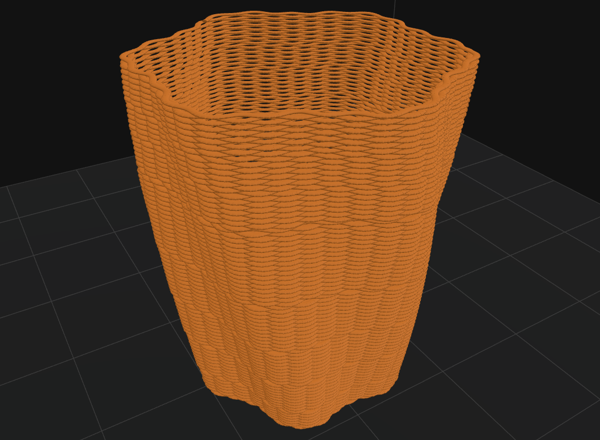

# YoRA Slicer

A slicer for large-format 3D printing with an industrial robot arm and a pellet extruder.

## How it works

1. **Prepare**: open a 3D model (STL, OBJ or 3MF), place it on the bed and choose the print settings.
2. **Preview**: slice it and check the toolpath layer by layer.
3. **Robot**: load your robot, set the tool and the bed, then check that the robot can reach every point and watch it print in a 3D simulation.
4. **Export**: save the robot program (or G-code) and run it on your machine.

## Features

- Walls, infill, brim, raft and spiral vase
- Angled layers for printing overhangs without supports
- Seam control: pick a point or draw a line on the part
- Surface patterns: waves, spikes, bumps, noise or a picture on the outer wall
- Even point spacing for smooth robot motion
- Robot reach, limit and collision checks with a 3D simulation
- Material library with heating zone temperatures
- Editable post-processor with start / layer / end events
- Light, dark and colour themes

## Surface patterns

Add texture to a part without changing the model. After slicing, open the **Surface pattern** card in **Preview**, pick a pattern and move the sliders: the toolpath updates as you go.

- **Sine, zigzag, spikes**: waves along the wall. Shift each layer by half a wave for a woven lattice.
- **Bumps** and **noise**: rows of domes or a random relief.
- **Image**: wrap a PNG or JPG (a logo or a texture) around the part.
- **Paint**: brush the pattern onto just the areas you want, or keep it off them.

## Getting started

Needs Windows and Python 3.10 or newer.

1. Download or clone this repository.
2. Double-click **`YoRA Slicer.bat`**. The first start installs what it needs (about a minute, needs internet).
3. Load a model or one of the samples and press **Slice**.

## License

MIT
