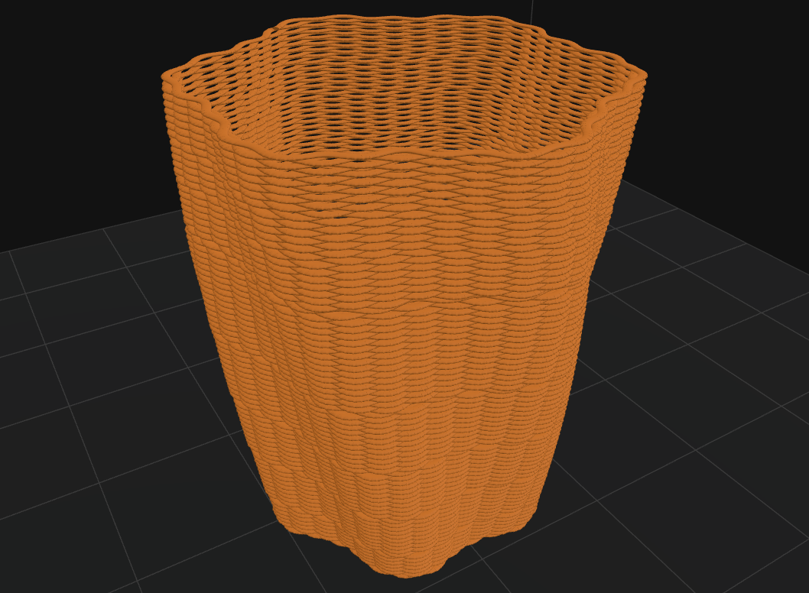
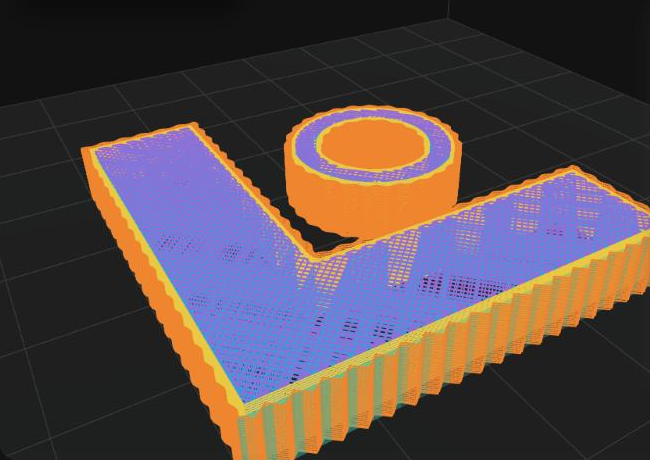

# YoRA Slicer

A slicer for large-format 3D printing with an industrial robot arm and a pellet extruder.

## How it works

1. **Setup**: your machine. Pick or save a robot cell (robot, tool, bed and controller) and check that the robot can reach the bed corners.
2. **Prepare**: add one or more parts, place them on the bed and choose the material and print settings.
3. **Preview**: slice and check the toolpath layer by layer, add surface patterns and look at overhangs.
4. **Robot check**: make sure the robot can reach every point within its limits without collisions, and watch it print in a 3D simulation.
5. **Export**: save the robot program (or G-code) and run it on your machine.

## Quick guide

Your first print, step by step:

1. **Set up the machine once.** In **Setup**, choose your robot, then your tool: its 3D model and the nozzle tip (TCP). Then the bed: its size and position. Under *Jog*, press **Go to bed corners**: green corners are reachable, red ones are not. Save it all as a robot cell so you only do this once.
2. **Add your parts.** In **Prepare**, open a STEP, STL, OBJ or 3MF file (or a sample), and add more parts if you like. Click a part to select it; double-click it to move or turn it with the mouse.
3. **Choose how it prints.** Pick a material, then set the layer height, walls, infill and seam. **Essentials** shows the main settings, **All** shows every setting.
4. **Slice.** Press **Slice**. In **Preview**, drag the layer slider to look inside, colour the toolpath by overhang to find steep walls, and try a surface pattern if you want texture.
5. **Check the robot.** In **Robot check**, press **Check robot path**. Fix anything marked red (reach, limits, collisions), then play the simulation.
6. **Export and print.** In **Export**, pick your robot's program format and save it. Copy the program to your controller and print.

Press **Save** (Ctrl+S) to keep everything as a `.yora` project, and **Ctrl+Z** to undo a change.

## Features

- Walls, infill, brim, raft and spiral vase
- Walls inside the part or centred on its surface, printed clockwise, counter-clockwise or alternating
- STEP, STL, OBJ and 3MF import
- Several parts on the bed: add, duplicate and arrange them
- Project files (`.yora`): the parts, every setting and the files they use, in one file
- Angled layers for printing overhangs without supports
- Curved layers: every layer square to a curve through the part, so bent parts print along their bend
- Layer data: time, path length, height, material and peak flow of each layer, as a chart and as preview colours
- Overhang view: colours steep walls and warns past the material's limit
- Seam control: pick a point or draw a line on the part
- Surface patterns: waves, spikes, bumps, noise or a picture on the outer wall, in up to four layers, on surfaces you paint or pick
- Even point spacing for smooth robot motion
- Robot reach, limit and collision checks with a 3D simulation
- Material library with heating zone temperatures
- Editable post-processor with start / layer / end events
- Undo / redo (Ctrl+Z / Ctrl+Y)
- Light, dark and colour themes

## Surface patterns

Add texture to a part without changing the model. After slicing, open the **Surface pattern** card in **Preview**, pick a pattern and move the sliders: the toolpath updates as you go.

- **Sine, zigzag, spikes**: waves along the wall. Shift each layer by half a wave for a woven lattice.
- **Bumps** and **noise**: rows of domes or a random relief.
- **Image**: wrap a PNG or JPG (a logo or a texture) around the part.
- **Paint**: brush the pattern onto just the areas you want, or keep it off them.
- **Fill**: click a surface to pick all of it at once. On a STEP part, one click picks one CAD face, and Alt+click also spreads over smooth edges. On STL, OBJ and 3MF parts it spreads until an edge bends more than the fill angle, so one click picks a flat side or the whole round body of a vase. Picked surfaces move with the part.
- **Skip slopes over**: keep the pattern off walls that lean more than a set angle, such as a shoulder or a chamfer.

### Pattern layers

Put up to four patterns on one part, for example a sine on the body and a picture on one face. The chips at the top of the card (`1 · Sine`, `2 · Zigzag`, `+ Layer`) pick the layer that the card edits.

1. Set up the first pattern as usual.
2. Press **+ Layer**, choose its pattern, then click the surfaces where it goes (Fill is already on). Press **Done**.
3. Choose how it meets the layers below: **Cover** replaces them where this layer is, **Add** puts its relief on top. **Edge blend** fades between them at the edges of a picked surface.

Each layer can be hidden, duplicated or deleted, and keeps its own waves per lap.

## Curved layers

Set **Layer strategy** to `curve` (Printing strategy) for a part that bends, like an arm or a bent tube. Every layer is then square to a curve through the middle of the part, so the part prints along its own bend instead of in flat layers that overhang, and the nozzle tilts with each layer.

YoRA finds the curve from the part (its middle line) and draws it in Prepare, with some of the layer planes. To choose another curve, use the **Curve** card:

- **Middle line**: the part's middle line, kept so you can drag its dots.
- **Pick edge**: the edges you can pick are highlighted; click near one and the curve follows it until it turns a corner. On a STEP part the borders between its faces count as edges too.
- **Draw line**: paint the curve on the part, bottom to top (Enter or Done finishes).
- **Curve from another part**: choose a guide part, such as a bent rod modelled where the print goes, and press **Use**. The curve is its middle line, and YoRA offers to take the guide off the bed so it isn't printed (Undo brings it back). A part you add lands in a free spot on the bed, so set its Position first.
- Drag any dot to bend the curve; it moves in the plane facing you. **Reset** goes back to the middle line found each time you slice. The points are also in **Curve points** (All settings).

Layer heights are measured along the curve. Where it bends, a layer is thicker on the outside of the bend than on the inside (more so with a curve along an edge on the inside of the bend). **Thicker / thinner layers by** chooses how the material follows: `flow` keeps the speed and changes the extrusion, `speed` keeps the extruder steady and slows the robot down where a layer is thicker. In Preview, **Color by → Layer height** and the extrusions show each bead's own thickness, and the layer card shows its range. YoRA warns when the bend is so tight for the part's width that layers would cross. A **Horizontal base height** prints the bottom flat first.

Seams: **Pick point** keeps the seam on that side of the part all the way along the bend; **Draw line** starts each layer where the line crosses it.

Not on curved layers yet: spiral vase, raft, and the robot check for collisions with the printed part.

## Wall placement and print direction

**Wall placement** (Layers & walls): `inside` keeps the whole bead inside the part, so the part keeps its size; `centered` puts the middle of the bead on the surface, half in and half out. **Print direction**: `ccw` or `cw` seen from above (from the nozzle on angled and curved layers), or `alternate`, which changes every layer.

## Layer data

In Preview, the card next to the layer slider shows the top layer's height, time, path length, travel, material and peak flow, with a chart of one of them over all layers; click the chart to go to a layer. **Color by** can also colour the toolpath by flow rate, layer time, layer path length or layer height.

## Tool angles A, B, C

After **Check robot path**, the Check tab shows the tool angles at the point on screen. **A** turns the nozzle around the vertical axis, **B** tilts it (90 points straight down with KUKA's tool X out of the nozzle) and **C** rolls it. These are not joints: the robot works out A1 to A6 from them.

YoRA holds A steady and only changes it when a joint would pass its limit. To choose the angles yourself, tick **Set A, B, C by hand**. The robot moves as you drag, the whole path is checked again when you let go, and the program gets exactly what you typed.

The values hold for the whole print, so A can no longer change to get out of a joint limit, and they replace the nozzle tilt of angled layers. A B other than 90 tilts the nozzle and the bead, and the check does not tell you if the nozzle would rub the walls, so try it on a small print first.

## KUKA corner blending

In the KUKA post-processor, **Blending type** chooses how the robot rounds each point:

- `c_dis`: starts a set distance from the point, the **Corner blending** setting in mm. 0 is an exact stop at every point.
- `c_vel`: starts when the speed drops to the **C_VEL speed** percent. It ignores Corner blending.

## Getting started

Needs Windows and Python 3.10 or newer.

1. Download or clone this repository.
2. Double-click **`YoRA Slicer.bat`**. The first start installs what it needs (about a minute, needs internet).
3. Load a model, a sample or a `.yora` project and press **Slice**.

After updating YoRA, close its window and start `YoRA Slicer.bat` again.

## Build the .exe

`Build exe.bat` packs YoRA Slicer into one folder that runs on a Windows PC without Python: start `YoRA Slicer.exe` in it. To give it to someone, zip the folder (`%USERPROFILE%\.yora\dist\YoRA Slicer`).

It opens in its own Edge or Chrome window and stops when you close that window. It works offline. Your materials, posts, robots and tools are kept in `%USERPROFILE%\.yora\profiles`, not in the program folder, so they are not part of the zip. Windows may warn about a new unsigned program the first time.

### Build the installer

`Build setup.bat` builds the program folder and packs it into one installer, `%USERPROFILE%\.yora\dist\YoRA-Slicer-Setup-<version>.exe` (about 50 MB), with [Inno Setup 6](https://jrsoftware.org/isinfo.php) (install it once: `winget install JRSoftware.InnoSetup`). The script is `installer\YoRA Slicer.iss`; the version comes from `yora/__init__.py`.

The installer needs no admin rights (it installs for the current user, or for everyone if chosen), adds a Start menu entry and an optional desktop shortcut, shows the license, and uninstalls from Windows Settings → Apps. A newer setup updates the installed version. The user's own files in `%USERPROFILE%\.yora` are never touched. It is not signed, so Windows shows "Windows protected your PC" the first time: **More info → Run anyway**.

## Safety and liability

YoRA Slicer is beta software, and it writes programs that move industrial robots. A robot can cause serious injury and damage.

- Check every program before you run it. Watch the simulation in YoRA first, then run it on the robot at reduced speed (T1 on KUKA, or your controller's manual reduced-speed mode) with your hand on the enabling switch and the emergency stop, and with nobody inside the cell.
- The robot check is only a model of your robot. It does not know your real cell (fences, hoses, cables, fixtures), and on curved layers it does not check collisions with the printed part.
- Not yet tested on a real robot: setting A, B, C by hand, KUKA `C_VEL` blending, and curved layers.

**You use YoRA Slicer and the programs it makes entirely at your own risk.** The authors accept no responsibility or liability for any injury, damage or loss that comes from using it. The software is provided "as is", without any warranty; see the license.

## License

Copyright (C) 2026 njmrvn

YoRA Slicer is free software: you can redistribute it and/or modify it under the terms of the GNU Affero General Public License as published by the Free Software Foundation, either version 3 of the License, or (at your option) any later version (AGPL-3.0-or-later, the license PrusaSlicer uses). It is distributed in the hope that it will be useful, but WITHOUT ANY WARRANTY; without even the implied warranty of MERCHANTABILITY or FITNESS FOR A PARTICULAR PURPOSE. See [LICENSE](LICENSE) for the full text.

In short: anyone may use YoRA Slicer for free, at home or at work. Anyone who shares a changed version, or offers one over a network, must publish its full source code under the same license.

STEP files are read with [occt-import-js](https://github.com/kovacsv/occt-import-js) and [Open CASCADE](https://dev.opencascade.org/), both under the LGPL 2.1. They are unchanged in `web/vendor/occt`, with their license texts.
